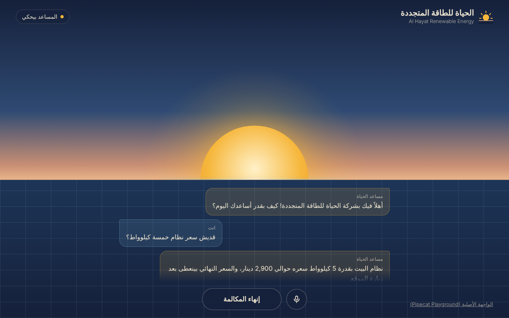

# call-center-AI

A voice customer-service assistant for **Al Hayat Renewable Energy** (شركة الحياة للطاقة المتجددة), a fictional company used for learning.
You talk to it in the browser and it talks back, answering from the company information file.

Built on [Pipecat](https://github.com/pipecat-ai/pipecat).



## How it works

| Part | Service |
| --- | --- |
| Speech to text (ears) | OpenAI |
| Reply (brain) | OpenAI, using `company_info.txt` |
| Text to speech (voice) | OpenAI, or Gemini if `GOOGLE_API_KEY` is set |
| Website | `hayat_ui.html` + `ui/app.js` (built from `web/`, see `web/README.md`) |
| Screen tools | `ui_tools.py`: the bot scrolls to and highlights what it talks about |

It runs in two ways:

| | On your computer | Online (Render) |
| --- | --- | --- |
| Start file | `demo_bot.py` (via `run-pipecat-demo.ps1`) | `app.py` |
| Audio connection | WebRTC | WebSocket at `/ws` |
| Address | http://localhost:7860/client/ | your Render link |

Both use the same bot (`bot_core.py`) and the same page. The page picks the right connection by itself.

## Files

- `bot_core.py`: the bot (listening, thinking, speaking)
- `company_info.txt`: what the assistant knows (edit it to change its answers)
- `hayat_ui.html`: the interface
- `demo_bot.py` + `run-pipecat-demo.ps1`: run it on your Windows computer
- `app.py` + `requirements.txt` + `render.yaml`: run it online

## Run it on your computer (Windows)

1. Install [Git for Windows](https://git-scm.com/download/win).
2. Open PowerShell in this folder and run:
   ```
   powershell -ExecutionPolicy Bypass -File .\run-pipecat-demo.ps1
   ```
3. Paste your OpenAI API key when asked. For the Gemini key, paste it or press Enter to skip.
   Keys are saved only in `pipecat\.env` on your PC and are never committed.
4. Open http://localhost:7860/client/, click **ابدأ المكالمة**, allow the microphone and start talking.

The original Pipecat Playground is still available at http://localhost:7860/classic/.

## Put it online (Render)

1. In Render: **New → Web Service**, connect this GitHub repo.
2. Settings:
   - Language: **Python 3**
   - Build command: `pip install -r requirements.txt`
   - Start command: `uvicorn app:app --host 0.0.0.0 --port $PORT`
   - Instance type: **Free**
3. Environment variables:
   - `OPENAI_API_KEY`: your OpenAI key (required)
   - `PYTHON_VERSION`: `3.12.8`
   - `ACCESS_CODE`: a password (optional). Then share the link as `https://your-app.onrender.com/?code=PASSWORD`
   - `GOOGLE_API_KEY`: only if you want the Gemini voice
   - `N8N_WEBHOOK_URL`: the n8n webhook that saves unanswered questions (see below)
4. Deploy. Check `https://your-app.onrender.com/health` shows `"openai_key_set": true`.

On Render's free plan the server sleeps after 15 minutes without use and takes about a minute to wake up. Open the link a minute before a demo.

## Screen tools

While it talks, the bot calls tools like `show_prices`, `show_branches` or
`book_site_visit`. The browser runs them: it scrolls to the right section,
highlights the item, opens the FAQ answer or fills the visit form, then sends
back a short `hint` telling the bot what to say next. Navigation is
client-side only, so the call never drops. Server side: `ui_tools.py`.
Browser side: `web/tools.js`.

## Unanswered questions (n8n)

When a caller asks something that isn't in `company_info.txt`, the bot calls its
`log_unanswered_question` tool, which POSTs the question to an n8n webhook
(`N8N_WEBHOOK_URL`). The n8n workflow **Unanswered Questions — Voice Bot→Data Table**
saves it in the data table **Al Hayat — Unanswered Questions** with the time
(Asia/Amman), the question, what info was missing, the language, a session id,
and whether the call came from `local` or `online`.

Use that table to decide what to add to `company_info.txt` next.

On your computer, add the same URL to `pipecat\.env`:
```
N8N_WEBHOOK_URL=https://<your-n8n>/webhook/<path>
```
Without it the bot still works; the questions just aren't saved.

## Notes

- Every call uses your OpenAI credit. Set a spending limit on your OpenAI key, and use `ACCESS_CODE` before sharing the link.
- Gemini's free tier allows about 10 voice requests per day. After that the bot shows text with no voice.
- The local script clones Pipecat into a `pipecat` folder the first time. That folder is not part of this repo.
